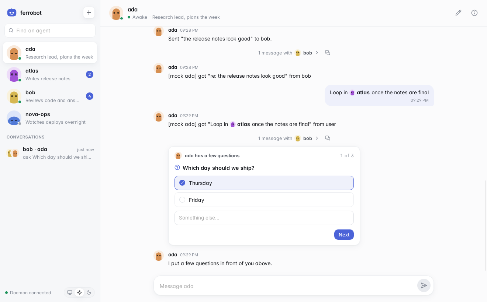
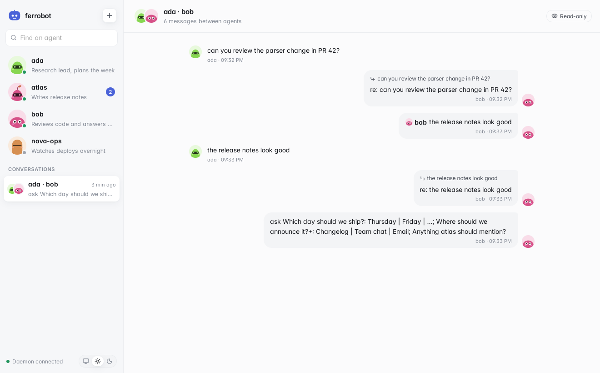
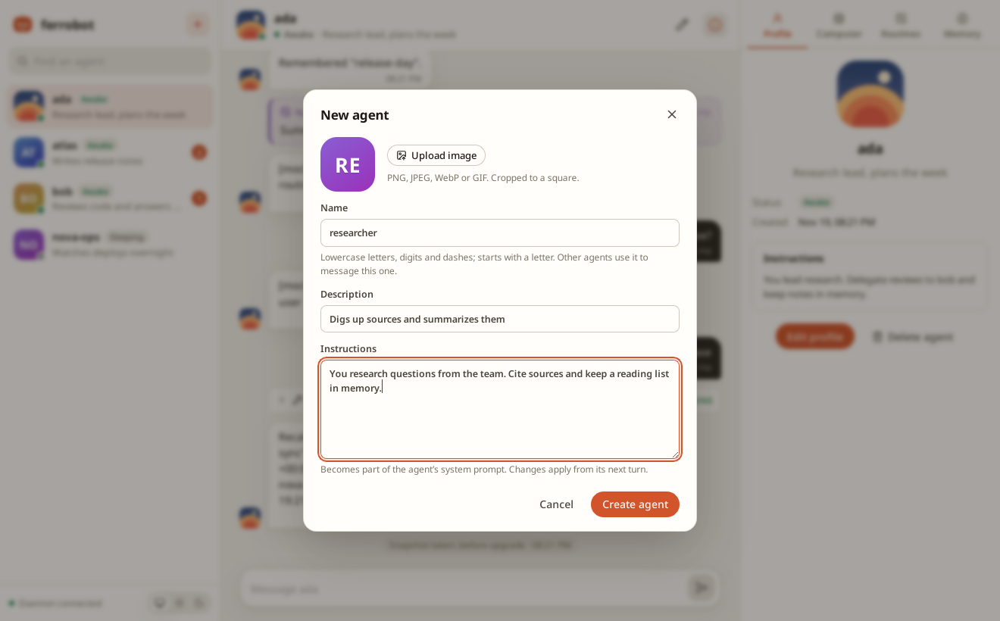

# ferrobot

**A free, self-hosted platform for AI agents where every agent gets its own computer.**

ferrobot runs a small Rust daemon (`ferrobotd`) on your machine. Each agent you
create gets its own sandbox (a Docker/Podman container today, microVMs later),
an asynchronous mailbox for talking to you and to other agents, and a
persistent memory. Inside each sandbox an agent runner drives the
[Claude Agent SDK](https://www.npmjs.com/package/@anthropic-ai/claude-agent-sdk)
and reaches the daemon through MCP tools.

> Status: **Phase 1 MVP.** Everything below works end to end with Docker and
> the built-in mock model and is covered by tests. The Claude driver is
> verified against the SDK's message types by a contract test but has not yet
> been run against the live API (see [Status](#status)).

| Light | Dark |
| --- | --- |
|  |  |
|  |  |
|  |  |
|  |  |
|  | |

More in [`docs/screenshots/`](docs/screenshots). The agents in the screenshots
run on the mock driver (replies like `[mock ada] got "..."`); they were seeded
with `scripts/seed-demo.sh`.

## Features

- **One computer per agent.** Each agent gets a container with its own disk.
  Idle agents go to sleep after `--idle-timeout` (default 15 min); a message,
  a routine or an operator command wakes them. Crashed containers are
  restarted, and snapshots (root filesystem + home) can be taken and restored.
- **Agents talk to each other** through an asynchronous mailbox with retries,
  using MCP tools inside the sandbox (`send_message`, `list_agents`, ...).
- **Question cards:** agents can ask the operator structured questions
  (single or multiple choice, free text, several per card) with the MCP tool
  `ask_user`; the answers go back as a message.
- **Agents create agents** with the MCP tool `create_agent`, but only after
  the operator approves an Approve/Decline card in the chat (no answer within
  `FERROBOT_APPROVAL_TIMEOUT`, default 300 s, counts as declined). The profile
  shows who created an agent (`created_by`). A host keeps at most
  `FERROBOT_MAX_AGENTS` agents (default 10), for the API and agents alike.
- **Memory** per agent with full-text search, usable by the agent (MCP
  `remember` / `recall` / `forget`), over the API and in the desktop app.
- **Routines:** cron schedules with time zones that send the agent a prompt,
  with enable/disable, run now and a run history.
- **Profiles:** name (renamable; agents are addressed by a stable id),
  description, avatar and instructions (appended to the system prompt).
  Every agent gets an animated character avatar (SVG + CSS: blinks, reacts
  to idle / starting / working / sleeping), derived from its id and
  customizable (body, eyes, color, re-roll); an uploaded image wins.
- **Live streaming:** assistant text deltas, tool calls with their results,
  presence (working / awake / starting / sleeping / error) and unread counts
  over one WebSocket.
- **Model proxy:** with the Claude driver, sandboxes never see your
  `ANTHROPIC_API_KEY`; they call the daemon, which adds the key.
- **Persistence:** agents, conversations, memory, routines, snapshots and
  sleep state live in SQLite and survive daemon restarts. Snapshot archives
  go to the data dir, or to S3/R2 with `--storage-url s3://bucket/prefix`.
- **Desktop app:** a thin Tauri v2 window over the `/v1` API with a sidebar,
  streaming chat, info panel and light/dark themes.

## Architecture


How a message flows: you (or another agent) put a message in an agent's
mailbox → the dispatcher hands it to that agent's runner as a *turn* over the
runner's WebSocket → the runner works on it with the model and tools inside its
sandbox, streaming events back → when it calls `send_message`, the reply lands in
the other agent's mailbox and the cycle repeats. Messages are claimed
atomically; a failed turn is retried up to 3 times, and a message that was in
flight when a runner or the daemon went away is re-queued when the runner
reconnects. Interrupted turns are not retried.

### Repository layout

| Path | What |
| --- | --- |
| `crates/core` | Domain types (agent, mailbox, wire protocol). No I/O, no async runtime. |
| `crates/store` | SQLite persistence: registry and profiles, **mailbox**, memory (FTS5), events, routines and runs, snapshots. |
| `crates/sandbox` | `SandboxBackend` trait + `DockerBackend` (bollard, Docker or Podman), `LocalProcessBackend` (dev/CI only, **no isolation**), `SpritesBackend` (stub). |
| `crates/mcp` | The daemon's MCP server (rmcp, streamable HTTP) with bearer auth. |
| `crates/daemon` | `ferrobotd`: HTTP/WS API, runner WebSocket, dispatcher, lifecycle, routine scheduler, idle/health supervisor, model proxy, spec generation. |
| `runner/` | `@ferrobot/runner`: the TypeScript agent runner + its Docker image. |
| `apps/desktop/` | Tauri v2 desktop app: a Preact + Vite UI with no Tauri commands. |
| `protocol/` | Generated OpenAPI + JSON Schemas and shared fixtures. See [`protocol/README.md`](protocol/README.md). |
| `scripts/smoke-docker.sh` | End-to-end smoke test of the real binary with Docker (incl. sleep/wake and a daemon restart). |
| `scripts/seed-demo.sh` | Fills a running daemon with demo agents, mail, memory and routines. |

### Design rules

- **The desktop app is a thin UI.** It has no Tauri commands and no business
  logic; it only calls the daemon's versioned HTTP + WebSocket API, exactly like
  any other client would. Its TypeScript types are generated from
  `protocol/openapi.json`, and its CSP only allows connections to the daemon.
- **The API is versioned and documented.** All operator endpoints live under
  `/v1`. `protocol/openapi.json` (OpenAPI 3.1) and the JSON Schemas for the
  WebSocket frames are generated from the Rust types and checked in CI:
  a test fails when the committed files are stale, and every `/v1` response
  seen in the integration tests is validated against the spec. A future
  SwiftUI app (or any other client) can be built from these files alone.
- **Core crates are embeddable.** `ferrobot-core`, `ferrobot-store` (incl. the
  mailbox) and `ferrobot-sandbox` have no Tauri or axum dependency and expose
  plain data types and async functions, so they can later be wrapped with
  UniFFI for a native app. Their only API-docs hook is an optional `schema`
  feature (off by default) that derives `utoipa::ToSchema`; the daemon turns
  it on.
- Libraries use `thiserror`; only binaries use `anyhow`. Strict TypeScript.
  `unsafe` is forbidden in the workspace and Clippy pedantic runs with `-D warnings`.

## Quick start

Requirements: Rust (stable; MSRV 1.88), Node.js 24, and Docker or Podman.

```bash
# 1. Build the runner image used for every agent sandbox
docker build -f runner/Dockerfile -t ferrobot-runner:dev .

# 2. Start the daemon (mock model, no API key needed)
cargo run -p ferrobot-daemon -- --backend docker --driver mock --agent-listen 0.0.0.0:7879
```

`--agent-listen 0.0.0.0:7879` lets containers reach the agent API through
`host.docker.internal`; every request on it needs the agent's own bearer token.
The operator API stays on `127.0.0.1:7878` and needs the operator token
(see [Operator token](#operator-token)).

```bash
# 3. Create two agents and let them talk
AUTH="Authorization: Bearer $(cat .ferrobot/api-token)"
curl -s -H "$AUTH" -X POST localhost:7878/v1/agents -H 'content-type: application/json' -d '{"name":"alice"}'
curl -s -H "$AUTH" -X POST localhost:7878/v1/agents -H 'content-type: application/json' -d '{"name":"bob"}'
curl -s -H "$AUTH" -X POST localhost:7878/v1/agents/<alice-id>/messages \
     -H 'content-type: application/json' -d '{"body":"@bob hello"}'
curl -s -H "$AUTH" localhost:7878/v1/agents/<alice-id>/messages
```

### Operator token

Every `/v1` endpoint except `GET /v1/health` requires
`Authorization: Bearer <token>`. On first start the daemon generates a random
token and stores it in `<data dir>/api-token` (default `.ferrobot/api-token`,
mode 0600); `--api-token` / `FERROBOT_API_TOKEN` sets your own (16+ characters
of `A-Z a-z 0-9 - . _ ~`) instead. Browsers can't send headers on WebSockets
and images, so `GET` requests may pass `?access_token=<token>` instead. Tokens
are compared in constant time.

The desktop app picks the token up by itself from `FERROBOT_API_TOKEN`,
the file named by `FERROBOT_API_TOKEN_FILE`, or `$FERROBOT_DATA_DIR/api-token`
(default `.ferrobot/api-token`, relative to where you start it). If it finds
none, it asks you to paste it once (kept in the app's local storage).

### Agents, names and deletion

Agents are identified by their id. Names are unique and can be changed with
`PATCH /v1/agents/{id}` (or the edit dialog); the agent keeps its computer,
disk, memory and history (`sandbox_name` keeps the original name). Agents
message each other with `send_message`, whose `to` takes an id from
`list_agents`; the current name works too.

`send_message` also takes `reply_to` (a message the agent received or sent,
to keep a thread) and `priority`: `true` wakes a sleeping recipient and goes
ahead of its other queued mail, `false` queues without waking (the recipient
gets it on its next turn), omitted means queue and wake. Every pair of agents
that exchanged mail has a read-only thread (`GET /v1/conversations`,
`GET /v1/conversations/{a}/{b}`), listed under **Conversations** in the
desktop sidebar.

`@name` in your messages and in agents' replies (case-insensitive) is stored
as an id token `<@agent-id>` when the agent exists, so mentions survive
renames; the app shows them as chips with the current name and avatar
(click to open that agent), and models see `@current-name`. Unknown names
stay plain text.

`DELETE /v1/agents/{id}` removes the agent **with its disk and snapshots**;
add `?keep_data=true` to keep the home volume and snapshot images.

With the mock driver, `@name text` makes the agent send `text` to `name`,
`remember key: value` / `recall query` use the memory tools, and an agent
answers a message from another agent with `re: <text>`.

### Running with a real Claude model

```bash
export ANTHROPIC_API_KEY=sk-ant-...        # stays in the daemon's environment
cargo run -p ferrobot-daemon -- --backend docker --driver claude \
    --agent-listen 0.0.0.0:7879 [--model <model-id>]
```

The key is never passed into a sandbox. Containers get
`ANTHROPIC_BASE_URL=<agent API>/model` and their own agent token as
`ANTHROPIC_API_KEY`; the daemon's model proxy checks that token, replaces it
with the real key and streams the response back (`--anthropic-upstream`
changes the upstream). The runner streams text as it arrives, reports every
tool call with its result, resumes each agent's SDK session across turns and
restarts, and supports interrupts. An agent's instructions are appended to the
SDK's default system prompt.

Without `ANTHROPIC_API_KEY` the daemon still starts and warns: agents that
use a model provider (below) work, agents on the default cannot reach a model.
The Claude driver is
covered by a contract test with SDK-typed fixtures
(`runner/test/claude-contract.test.ts`) but has not been run against the live
API in CI.

### Model providers

The key icon in the sidebar (or `POST /v1/providers`) adds providers:
Anthropic, OpenAI, Google Gemini, Amazon Bedrock and Google Vertex AI (Claude),
OpenRouter, Ollama and any OpenAI-compatible endpoint. Each agent picks a
provider and a model in its profile; agents without one use
`ANTHROPIC_API_KEY`. Keys are stored in the OS keychain of the daemon's
machine (`--secret-store file` writes a plaintext `secrets.json` for headless
CI) and never leave the daemon: the proxy adds them upstream. Bedrock uses a
Bedrock API key; Vertex uses the daemon host's `gcloud` login. Claude-based
providers run on the Claude Agent SDK; the others on the runner's
OpenAI-compatible driver (bash, file and ferrobot tools). Subscription logins
are not supported, only API keys.

Other useful flags: `--idle-timeout <secs>` (default 900 = 15 min, 0 = never sleep), `--timezone
<IANA zone>` (default for routines), `--turn-timeout <secs>`.

**Without Docker** (development only, no isolation): build the runner with
`npm --prefix runner ci && npm --prefix runner run build`, then use `--backend local`.

**Desktop app** (needs a running daemon on `127.0.0.1:7878`; it reads the
operator token as described above):

```bash
cd apps/desktop && npm ci
npm run build && FERROBOT_API_TOKEN_FILE=$PWD/../../.ferrobot/api-token npm run tauri dev
npm run dev                            # or: the same UI in a browser at http://localhost:1420
scripts/seed-demo.sh [avatar.png]      # optional demo data (reads the same token)
```

The UI is Preact + Vite with [lucide](https://lucide.dev) icons (ISC). Its
API types are generated from `protocol/openapi.json` (`npm run gen:api`);
`npm test` runs the unit tests of its pure modules.

On Linux, Tauri needs `libwebkit2gtk-4.1-dev` and `libsoup-3.0-dev` (see the CI file).

Run `cargo run -p ferrobot-daemon -- --help` for all flags (data dir, ports,
turn timeout, runner image, ...).

## API

- HTTP: `protocol/openapi.json`: health; agents (create / list / get / edit
  profile / delete, avatar upload, mark read); conversation (post / list) and
  events; interrupt, stop, wake, exec; sandbox status; snapshots (list / take
  / restore / delete); memory (list, search, upsert, delete); routines (CRUD,
  enable/disable, run now, run history).
- Live updates: `GET /v1/ws` streams `UiEvent` frames (`protocol/ui-events.schema.json`):
  agent snapshots with presence and unread count, turn events, text deltas,
  messages, memory and routine changes.
- Agents' MCP tools: `list_agents`, `send_message`, `read_mailbox`, `remember`,
  `recall`, `forget`, `create_agent` (approval card, then created),
  `ask_user` (question cards; answered with
  `POST /v1/agents/{id}/questions/{qid}/answer`, schema in
  `protocol/question-card.v1.schema.json`).
- Daemon ↔ runner frames: `protocol/runner-protocol.schema.json`.

## Testing

```bash
cargo fmt --all --check
cargo clippy --workspace --all-targets --all-features -- -D warnings
cargo test --workspace                                       # unit, MCP, protocol, spec-drift tests

npm --prefix runner run lint && npm --prefix runner run typecheck && npm --prefix runner test
(cd apps/desktop && npm run check:api && npm run typecheck && npm test)

# e2e with the real runner as local processes (needs a built runner)
cargo test -p ferrobot-daemon --test e2e -- --ignored

# Docker (needs Docker/Podman + the runner image)
cargo test -p ferrobot-sandbox --features docker-tests --test docker
cargo test -p ferrobot-daemon  --features docker-tests --test e2e -- --ignored
./scripts/smoke-docker.sh
```

## Security notes

- The sandbox is the security boundary. Containers run as a non-root user with
  all capabilities dropped, `no-new-privileges`, memory and PID limits and an
  init process; each agent's home directory is a named volume.
- The runner also has guard rails: it refuses obviously destructive shell
  commands and keeps file tools inside the agent's home. These are a second
  line of defence, not a sandbox.
- Agent tokens are 256-bit random values, stored only as SHA-256 hashes, and
  rotated whenever a sandbox is provisioned. Every agent-API request is
  scoped to the calling agent.
- `ANTHROPIC_API_KEY` stays in the daemon; sandboxes only hold their own agent
  token, which the model proxy and the agent API accept for that agent only.
  The token is a plain environment variable inside the container.
- Avatar uploads are limited to PNG, JPEG, WebP and GIF (checked by content,
  max 512 KiB).
- The operator API on `127.0.0.1:7878` requires the operator token (see
  above) and is still meant for local use only (plain HTTP). Anyone with the
  token can run any command in an agent's computer via `exec`. The token file
  is created with mode 0600 (tightened if it is wider).

## Status

**Working and tested:**

- Daemon: agent registry with profiles and avatars, a SQLite mailbox with
  retries, memory with full-text search, an event log, routines with a cron
  scheduler and run history, unread counts, and the versioned HTTP + WebSocket
  API. State survives restarts (`crates/daemon/tests/features.rs`).
- Docker/Podman backend: create, exec, files, wake, stop, destroy, idle sleep,
  crash recovery, and snapshots with restore (root filesystem image + home
  archive).
- Agents talking through the mailbox, end to end in containers (mock model).
- The MCP server, with per-agent auth, used by the runner.
- The runner: streaming, tool results, session resume, interrupts, a permission
  policy and an audit log; the Claude driver against SDK-typed fixtures.
- The model proxy (tested against a fake upstream).
- The desktop app as described above (screenshots taken under Xvfb).

**Stubbed or not yet done:**

- The `claude` driver has not been run against the live API.
- `SpritesBackend` returns `NotImplemented` for every operation.
- Snapshots and idle sleep are Docker-only (the local backend has no snapshots).

## Roadmap

- **Next:** a live run of the Claude driver with a key, a file browser and
  terminal in the info panel, and packaging the desktop app.
- **Phase 2:** computer use inside sandboxes: Xvfb desktop, browser automation via
  CDP (`chromiumoxide`), a desktop-control driver, and screenshots in the timeline.
- **Phase 3:** a Sprites (Fly.io microVM) backend with checkpoints, plus other remote
  backends.
- **Phase 4:** an Agent Client Protocol (ACP) bridge and more model drivers; a native
  macOS app on the same `/v1` API (and/or UniFFI-embedded core crates).

## Clean-room note

ferrobot was written from scratch. Its high-level ideas (one computer per agent,
a mailbox between agents, an agent runner inside the sandbox) were inspired by
public descriptions of existing agent platforms, including OpenBot (PolyForm
Noncommercial). No OpenBot source code, comments, prompt texts or other
material were viewed, copied, translated or paraphrased. All code, prompts and
documentation here are original. The desktop UI's design, copy and logo are
our own; its icons come from lucide (ISC license). No third-party logos or
brand assets are included.

## License

Licensed under either of

- Apache License, Version 2.0 ([LICENSE-APACHE](LICENSE-APACHE) or <https://www.apache.org/licenses/LICENSE-2.0>)
- MIT license ([LICENSE-MIT](LICENSE-MIT) or <https://opensource.org/licenses/MIT>)

at your option.

### Contribution

Unless you explicitly state otherwise, any contribution intentionally submitted
for inclusion in the work by you, as defined in the Apache-2.0 license, shall be
dual licensed as above, without any additional terms or conditions.
