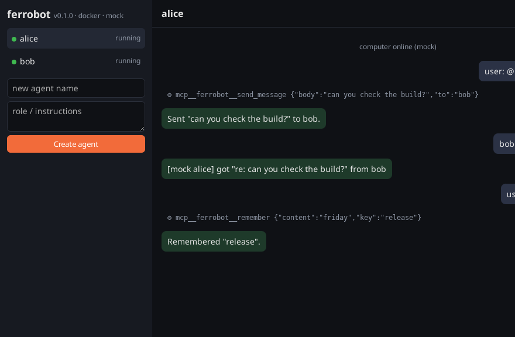
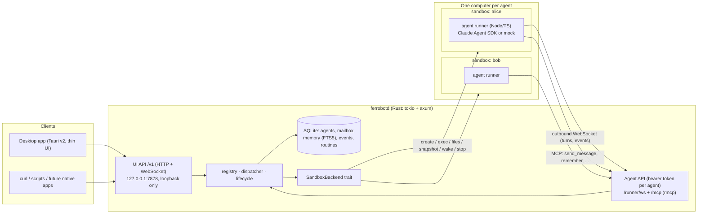

# ferrobot

**A free, self-hosted platform for AI agents where every agent gets its own computer.**

ferrobot runs a small Rust daemon (`ferrobotd`) on your machine. Each agent you
create gets its own sandbox (a Docker/Podman container today, microVMs later),
an asynchronous mailbox for talking to you and to other agents, and a
persistent memory. Inside each sandbox an agent runner drives the
[Claude Agent SDK](https://www.npmjs.com/package/@anthropic-ai/claude-agent-sdk)
and reaches the daemon through MCP tools.

> Status: **Phase 0 proof of concept.** It works end to end with Docker and a
> mock model. The Claude driver is implemented but has not been run against
> the real API yet (see [Status](#status)).



## Architecture



How a message flows: you (or another agent) put a message in an agent's
mailbox → the dispatcher hands it to that agent's runner as a *turn* over the
runner's WebSocket → the runner works on it with the model and tools inside its
sandbox, streaming events back → when it calls `send_message`, the reply lands in
the other agent's mailbox and the cycle repeats. Messages are claimed
atomically; a failed turn is retried up to 3 times, and a message that was in
flight when a runner or the daemon went away is re-queued when the runner
reconnects. Interrupted turns are not retried.

### Repository layout

| Path | What |
| --- | --- |
| `crates/core` | Domain types (agent, mailbox, wire protocol). No I/O, no async runtime. |
| `crates/store` | SQLite persistence: registry, **mailbox**, memory (FTS5), events, routines (schema only). |
| `crates/sandbox` | `SandboxBackend` trait + `DockerBackend` (bollard, Docker or Podman), `LocalProcessBackend` (dev/CI only, **no isolation**), `SpritesBackend` (stub). |
| `crates/mcp` | The daemon's MCP server (rmcp, streamable HTTP) with bearer auth. |
| `crates/daemon` | `ferrobotd`: HTTP/WS API, runner WebSocket, dispatcher, lifecycle, spec generation. |
| `runner/` | `@ferrobot/runner`: the TypeScript agent runner + its Docker image. |
| `apps/desktop/` | Tauri v2 desktop app (thin UI). |
| `protocol/` | Generated OpenAPI + JSON Schemas and shared fixtures. See [`protocol/README.md`](protocol/README.md). |
| `scripts/smoke-docker.sh` | End-to-end smoke test of the real binary with Docker. |

### Design rules

- **The desktop app is a thin UI.** It has no Tauri commands and no business
  logic; it only calls the daemon's versioned HTTP + WebSocket API, exactly like
  any other client would. Its TypeScript types are generated from
  `protocol/openapi.json`, and its CSP only allows connections to the daemon.
- **The API is versioned and documented.** All operator endpoints live under
  `/v1`. `protocol/openapi.json` (OpenAPI 3.1) and the JSON Schemas for the
  WebSocket frames are generated from the Rust types and checked in CI:
  a test fails when the committed files are stale, and every `/v1` response
  seen in the integration tests is validated against the spec. A future
  SwiftUI app (or any other client) can be built from these files alone.
- **Core crates are embeddable.** `ferrobot-core`, `ferrobot-store` (incl. the
  mailbox) and `ferrobot-sandbox` have no Tauri or axum dependency and expose
  plain data types and async functions, so they can later be wrapped with
  UniFFI for a native app. Their only API-docs hook is an optional `schema`
  feature (off by default) that derives `utoipa::ToSchema`; the daemon turns
  it on.
- Libraries use `thiserror`; only binaries use `anyhow`. Strict TypeScript.
  `unsafe` is forbidden in the workspace and Clippy pedantic runs with `-D warnings`.

## Quick start

Requirements: Rust (stable; MSRV 1.88), Node.js 24, and Docker or Podman.

```bash
# 1. Build the runner image used for every agent sandbox
docker build -f runner/Dockerfile -t ferrobot-runner:dev .

# 2. Start the daemon (mock model, no API key needed)
cargo run -p ferrobot-daemon -- --backend docker --driver mock --agent-listen 0.0.0.0:7879
```

`--agent-listen 0.0.0.0:7879` lets containers reach the agent API through
`host.docker.internal`; every request on it needs the agent's own bearer token.
The operator API stays on `127.0.0.1:7878`.

```bash
# 3. Create two agents and let them talk
curl -s -X POST localhost:7878/v1/agents -H 'content-type: application/json' -d '{"name":"alice"}'
curl -s -X POST localhost:7878/v1/agents -H 'content-type: application/json' -d '{"name":"bob"}'
curl -s -X POST localhost:7878/v1/agents/<alice-id>/messages \
     -H 'content-type: application/json' -d '{"body":"@bob hello"}'
curl -s localhost:7878/v1/agents/<alice-id>/messages
```

With the mock driver, `@name text` makes the agent send `text` to `name`,
`remember key: value` / `recall query` use the memory tools, and an agent
answers a message from another agent with `re: <text>`.

**Real model:** `ANTHROPIC_API_KEY=sk-... cargo run -p ferrobot-daemon -- --backend docker --driver claude --agent-listen 0.0.0.0:7879`
(optionally `--model <id>`).

**Without Docker** (development only, no isolation): build the runner with
`npm --prefix runner ci && npm --prefix runner run build`, then use `--backend local`.

**Desktop app:**

```bash
cd apps/desktop && npm ci && npm run build
npm run tauri dev          # or: cd src-tauri && cargo run
```

On Linux, Tauri needs `libwebkit2gtk-4.1-dev` and `libsoup-3.0-dev` (see the CI file).

Run `cargo run -p ferrobot-daemon -- --help` for all flags (data dir, ports,
turn timeout, runner image, ...).

## API

- HTTP: `protocol/openapi.json`: health, agents (create / list / get / delete),
  mailbox (post / list), events (poll), interrupt, stop, wake, snapshot, exec,
  sandbox removal.
- Live updates: `GET /v1/ws` streams `UiEvent` frames (`protocol/ui-events.schema.json`).
- Agents' MCP tools: `list_agents`, `send_message`, `read_mailbox`, `remember`,
  `recall`, `forget`.
- Daemon ↔ runner frames: `protocol/runner-protocol.schema.json`.

## Testing

```bash
cargo fmt --all --check
cargo clippy --workspace --all-targets --all-features -- -D warnings
cargo test --workspace                                       # unit, MCP, protocol, spec-drift tests

npm --prefix runner run lint && npm --prefix runner run typecheck && npm --prefix runner test

# e2e with the real runner as local processes (needs a built runner)
cargo test -p ferrobot-daemon --test e2e -- --ignored

# Docker (needs Docker/Podman + the runner image)
cargo test -p ferrobot-sandbox --features docker-tests --test docker
cargo test -p ferrobot-daemon  --features docker-tests --test e2e -- --ignored
./scripts/smoke-docker.sh
```

## Security notes

- The sandbox is the security boundary. Containers run as a non-root user with
  all capabilities dropped, `no-new-privileges`, memory and PID limits and an
  init process; each agent's home directory is a named volume.
- The runner also has guard rails: it refuses obviously destructive shell
  commands and keeps file tools inside the agent's home. These are a second
  line of defence, not a sandbox.
- Agent tokens are 256-bit random values, stored only as SHA-256 hashes, and
  rotated whenever a sandbox is provisioned. Every agent-API request is
  scoped to the calling agent.
- **Known PoC limitations:** the agent token and `ANTHROPIC_API_KEY` are plain
  environment variables inside the container (anything running there can read
  them). A daemon-side model proxy is on the roadmap. The operator API on
  `127.0.0.1:7878` is unauthenticated and meant for local use only.

## Status

**Working and tested (Phase 0):**

- Daemon with the agent registry, a SQLite mailbox with retries, memory with full-text
  recall, an event log, and the versioned HTTP + WebSocket API.
- Docker/Podman backend: create, exec, file read/write, snapshot (`docker commit`),
  wake, stop and destroy. Agents survive daemon restarts; runners reconnect.
- Two agents talking through the mailbox, end to end in containers (mock model).
- The MCP server, with per-agent auth, used by the runner.
- The runner, with session persistence and resume, interrupts, a permission policy and an audit log.
- The desktop UI: an agent list, a create form, a live timeline, a composer and
  interrupt/stop/wake.

**Stubbed or not yet done:**

- The `claude` driver has not been run against the real API.
- `SpritesBackend` returns `NotImplemented` for every operation.
- Routines have a database schema but no scheduler yet.
- Snapshots can't be restored yet.
- The UI API has no authentication.

## Roadmap

- **Phase 1:** a routines scheduler, snapshot restore, a model/API-key proxy (no
  secrets in sandboxes), auth for the UI API, and a richer desktop app
  (memory browser, file view, terminal).
- **Phase 2:** computer use inside sandboxes: Xvfb desktop, browser automation via
  CDP (`chromiumoxide`), a desktop-control driver, and screenshots in the timeline.
- **Phase 3:** a Sprites (Fly.io microVM) backend with checkpoints, plus other remote
  backends.
- **Phase 4:** an Agent Client Protocol (ACP) bridge and more model drivers; a native
  macOS app on the same `/v1` API (and/or UniFFI-embedded core crates).

## Clean-room note

ferrobot was written from scratch. Its high-level ideas (one computer per agent,
a mailbox between agents, an agent runner inside the sandbox) were inspired by
public descriptions of existing agent platforms, including OpenBot (PolyForm
Noncommercial). No OpenBot source code, comments, prompt texts or other
material were viewed, copied, translated or paraphrased. All code, prompts and
documentation here are original.

## License

Licensed under either of

- Apache License, Version 2.0 ([LICENSE-APACHE](LICENSE-APACHE) or <https://www.apache.org/licenses/LICENSE-2.0>)
- MIT license ([LICENSE-MIT](LICENSE-MIT) or <https://opensource.org/licenses/MIT>)

at your option.

### Contribution

Unless you explicitly state otherwise, any contribution intentionally submitted
for inclusion in the work by you, as defined in the Apache-2.0 license, shall be
dual licensed as above, without any additional terms or conditions.
