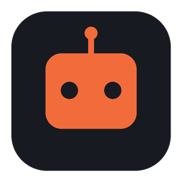
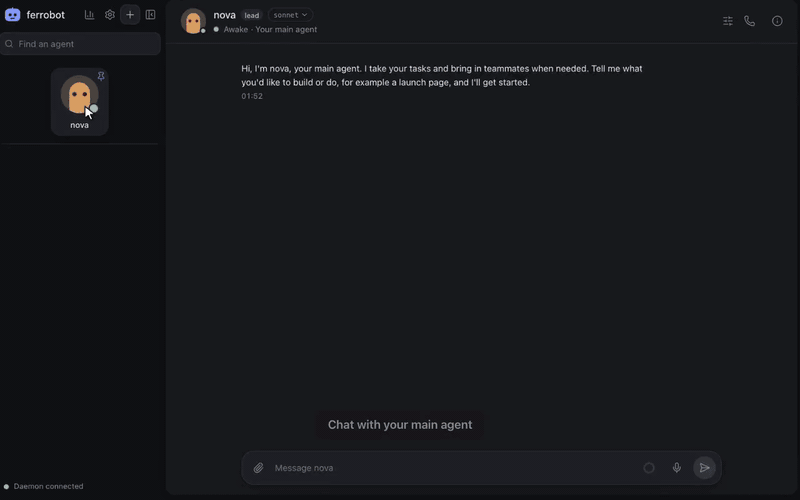
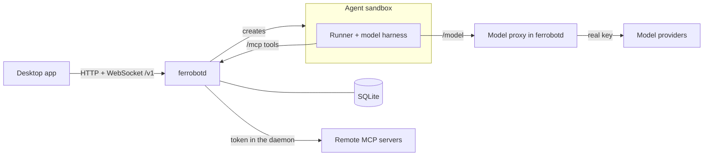

<div align="center">



# ferrobot

**A self-hosted team of AI agents. Each one gets its own computer.**

[](https://github.com/byQuexo/ferrobot/actions/workflows/ci.yml)
[](#contributing-security-license)
[](https://github.com/byQuexo/ferrobot/releases/tag/v0.1.0)
[](#download)
[](#download)

</div>



Also as [MP4](docs/assets/demo.mp4) (real Claude Sonnet 5.5 turns; waits sped up 2x, long ones shortened) · Voice room video: coming soon ([script](docs/launch/voice-room-script.md))

## Why ferrobot

ferrobot is a small Rust daemon on your machine and a thin desktop app on top.
Every agent gets its own sandboxed computer, a mailbox to you and the other
agents, a memory and a schedule, and works with the model you pick. Model keys
never enter a sandbox: agents reach their model through the daemon's proxy,
which adds the real key.

## Features

- **Agents and chat.** Agents with profiles and animated avatars; they ask you
  through question cards and share files you open in the chat.
- **Mail and tasks between agents.** Agents message each other, delegate tasks
  and get the answers back automatically, even while they sleep.
- **A computer per agent.** Docker sandboxes with a persistent home, warm and
  cold sleep, snapshots, and encrypted archives for idle agents.
- **Keys stay in the daemon.** A model proxy swaps in the real key; keys live
  in the OS keychain and are managed in one Vault in Settings.
- **Providers and drivers.** Claude (Agent SDK), any OpenAI-compatible API
  including local Ollama, OpenAI Codex, Gemini CLI, OpenRouter, Amazon
  Bedrock and Google Vertex AI.
- **MCP connectors.** Remote MCP servers with token or OAuth sign-in, a catalog
  of vendor servers and keyless ones, and a first connection check. Agents ask
  for a token on a card with a hidden field ([clip](docs/assets/clips/key-card.mp4)).
- **Routines.** Prompts on a cron schedule; agents can set up their own after
  you approve a card ([clip](docs/assets/clips/routine.mp4)).
- **Memory.** Per-agent memory with full-text search, plus a global memory
  every agent can read ([clip](docs/assets/clips/memory.mp4)).
- **Usage and costs.** Tokens and estimated costs per agent, model and
  provider, a daily chart and CSV export ([clip](docs/assets/clips/usage-csv.mp4));
  OpenRouter calls at the cost it reports.
- **Voice.** Calls with an agent, read aloud as it streams; several agents
  share a call room and talk to each other.
- **Files and share links.** Files from an agent's computer, shared with
  signed links.

## Architecture



The desktop app holds no business logic; it is one client of the daemon's
versioned API. More in the [wiki](../../wiki/Architecture).

## Download

Version 0.1.0 on the [release page](https://github.com/byQuexo/ferrobot/releases/tag/v0.1.0):
`ferrobot_0.1.0_universal.dmg` (macOS, Apple silicon and Intel) and
`ferrobot_0.1.0_x64-setup.exe` (Windows); `SHA256SUMS` lists the checksums.
The app needs [Docker Desktop](https://www.docker.com/products/docker-desktop/)
and starts its own daemon.

The installers are not signed, so the system warns once:

- **macOS:** right-click (or Control-click) the app in Applications, choose
  **Open**, then **Open** again.
- **Windows:** when SmartScreen says "Windows protected your PC", click
  **More info**, then **Run anyway**.

## Quickstart (Docker + Ollama, no API key)

Under five minutes, plus two downloads of about 2 GB each.

1. Install and start [Docker Desktop](https://www.docker.com/products/docker-desktop/).
2. Install [Ollama](https://ollama.com/download) and run `ollama pull qwen2.5:3b`.
3. Install ferrobot from the [download](#download) and open it.
4. In **Settings → Model providers**, add an **Ollama** provider (no key needed).
5. Create an agent with that provider and the model `qwen2.5:3b`, and ask it:
   "Write today's date into a file and tell me what you wrote."

A 3B model proves the plumbing; for real work pick a larger model or a cloud
provider.

### Build from source

You need Rust (stable), Node.js 24 and Docker.

```sh
docker build -f runner/Dockerfile -t ferrobot-runner:dev .
cargo build -p ferrobot-daemon
./target/debug/ferrobotd --backend docker --driver mock   # no key needed
cd apps/desktop && npm ci && npm run tauri dev            # the app
```

Details, tests and the release build: [Getting Started](../../wiki/Getting-Started)
and [CLAUDE.md](CLAUDE.md).

## Status

ferrobot is early. The desktop app, agents in Docker and voice rooms have been
used live on macOS. Claude (Anthropic API), OpenRouter and local Ollama have
run against the real services; OpenAI, Gemini, Bedrock and Vertex have only
been tested against fakes so far. Firecracker sandboxes are experimental and
have never booted a microVM. The Windows build and its keychain have not run
on real hardware. Details: [Roadmap](../../wiki/Roadmap) and
[Ideas](../../wiki/Ideas).

## Contributing, security, license

- **Contributing:** see [CONTRIBUTING.md](CONTRIBUTING.md) and the
  [Code of Conduct](CODE_OF_CONDUCT.md).
- **Security:** report vulnerabilities as described in [SECURITY.md](SECURITY.md).
- **License:** MIT OR Apache-2.0, at your option ([MIT](LICENSE-MIT),
  [Apache-2.0](LICENSE-APACHE)); contributions are dual licensed the same way.

ferrobot is written from scratch; it contains no third-party code, prompts or
brand assets beyond its listed dependencies and lucide icons.
