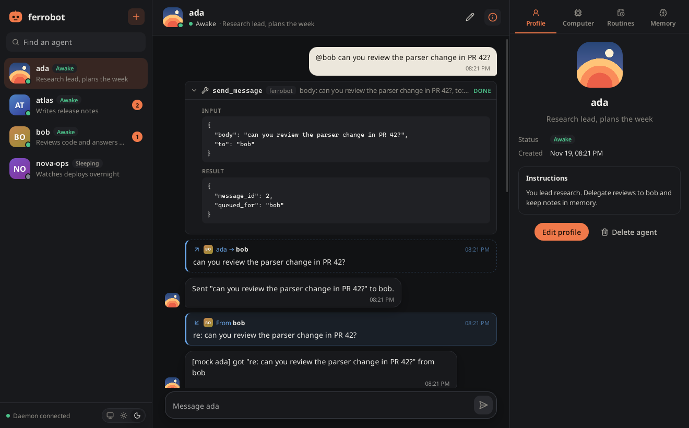
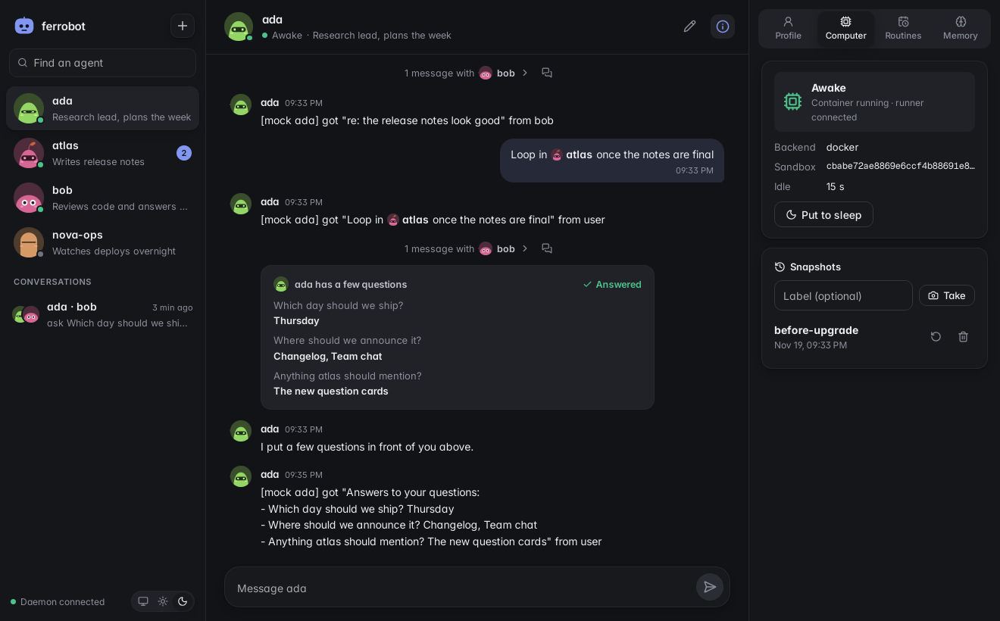
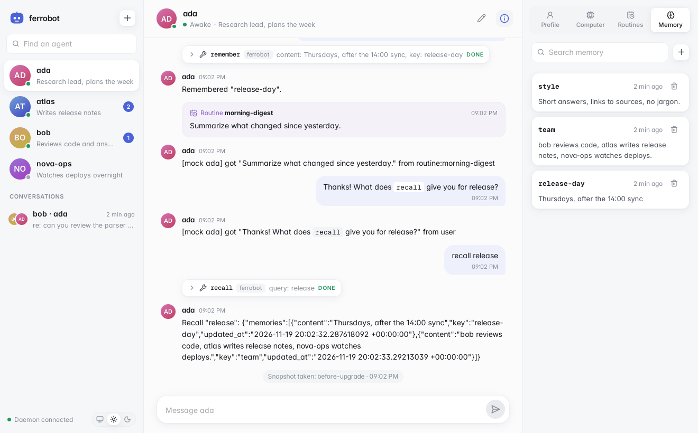
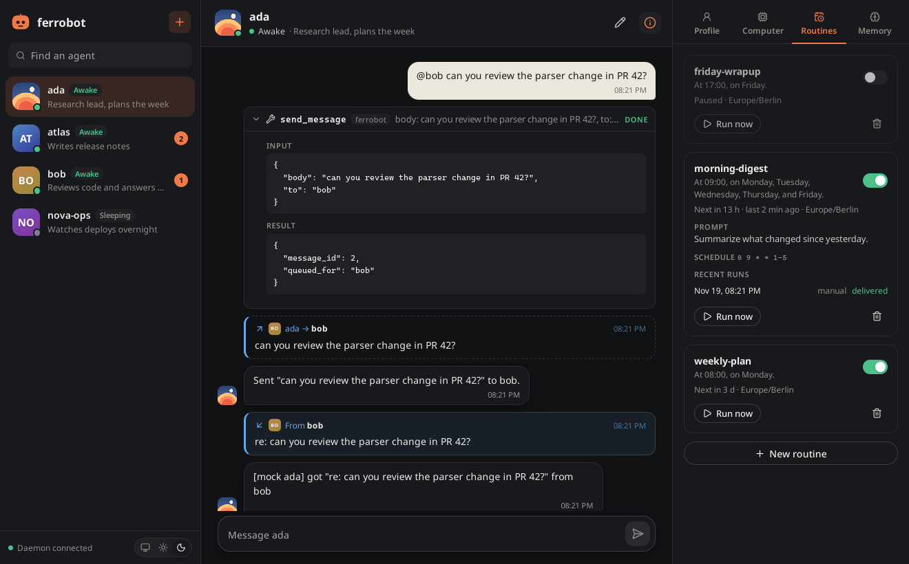
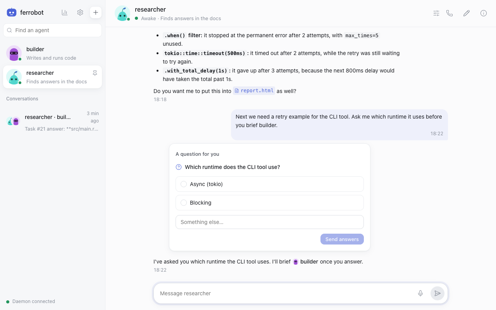
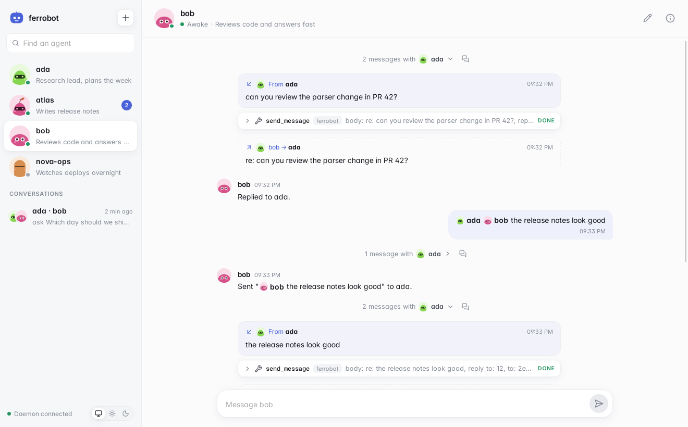
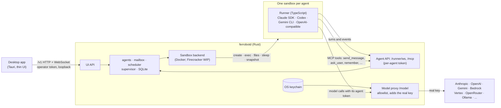

# ferrobot

**A free, self-hosted platform for a team of AI agents where every agent gets its own computer.**

A small Rust daemon (`ferrobotd`) runs on your machine and gives each agent a
sandboxed computer (a Docker container today), a mailbox to talk to you and to
the other agents, a memory, routines and question cards for you to answer.
Inside each sandbox a runner drives the model harness you pick (the Claude
Agent SDK, OpenAI's Codex, Gemini CLI, or a built-in loop for any
OpenAI-compatible API, including local models on Ollama). Model keys never
enter a sandbox: agents reach their model through the daemon's proxy, which
adds the real key. A desktop app for macOS and Windows is the thin window on
top.


The agents in the demo run on the mock driver; the usage comes from one real
turn on a local Ollama model. Also as [MP4](docs/assets/demo.mp4).

## Download

Version 0.1.0: [release page](https://github.com/byQuexo/ferrobot/releases/tag/v0.1.0).

- **macOS** (Apple silicon and Intel): `ferrobot_0.1.0_universal.dmg`
- **Windows** (x64): `ferrobot_0.1.0_x64-setup.exe`
- `SHA256SUMS` lists the checksums.

The app needs [Docker Desktop](https://www.docker.com/products/docker-desktop/)
(it says so on first start when Docker is missing). It starts its own daemon
and pulls the agents' image (`ghcr.io/byquexo/ferrobot-runner`, about 2 GB)
the first time an agent starts.

**Unsigned builds.** Unless the release notes say they are signed, the
installers are not signed, so the operating system warns once:

- macOS: right-click (or Control-click) the app in Applications, choose
  **Open**, then **Open** again. Later starts work normally.
- Windows: SmartScreen says "Windows protected your PC"; click
  **More info**, then **Run anyway**.

## Quick start (macOS, no API key)

About five minutes plus two downloads of about 2 GB each (a local model and
the agents' image). Everything stays on your machine.

1. Install and start [Docker Desktop](https://www.docker.com/products/docker-desktop/).
2. Install [Ollama](https://ollama.com/download) and pull a small model:
   `ollama pull qwen2.5:3b`
3. Install the app from the [download](#download) and open it.
4. In **Settings → Model providers**, add an **Ollama** provider (no key; the
   default URL `http://127.0.0.1:11434/v1` is right for a local Ollama).
5. Create an agent with that provider and the model `qwen2.5:3b`, and send it
   a message: "Write today's date into a file and tell me what you wrote."

A 3B model proves the plumbing (a sandbox, a shell tool call, the proxy), not
much more. For real work pick a larger model or a cloud provider; the keys go
into the OS keychain of your machine.

| Light | Dark |
| --- | --- |
|  |  |
|  |  |
|  |  |
|  |  |
|  | |

More in [`docs/screenshots/`](docs/screenshots). The agents in the screenshots
run on the mock driver; they were seeded with `scripts/seed-demo.sh`.

## Features

- **One computer per agent.** Each agent gets a container with its own disk.
  Idle agents are paused after `--warm-after` (default 5 min, Docker) and
  stopped after `--idle-timeout` (default 15 min); a message,
  a routine or an operator command wakes them. Crashed containers are
  restarted, and snapshots (root filesystem + home) can be taken and restored.
- **Agents talk to each other** through an asynchronous mailbox with retries,
  using MCP tools inside the sandbox (`send_message`, `list_agents`, ...).
  Mail from an agent wakes a sleeping one.
- **Delegated tasks:** `assign_task` (or `create_agent` with a `task`) tracks
  work handed to a teammate; the delegate's answer goes back to the assigner
  when its turn ends, with one reminder if it goes quiet (`list_tasks`).
- **Question cards:** agents can ask the operator structured questions
  (single or multiple choice, free text, several per card) with the MCP tool
  `ask_user`; the answers go back as a message.
- **Agents create agents** with the MCP tool `create_agent`, but only after
  the operator approves an Approve/Decline card in the chat (no answer within
  `FERROBOT_APPROVAL_TIMEOUT`, default 300 s, counts as declined). The profile
  shows who created an agent (`created_by`). A host keeps at most
  `FERROBOT_MAX_AGENTS` agents (default 10), for the API and agents alike.
- **Memory** per agent with full-text search, usable by the agent (MCP
  `remember` / `recall` / `forget`), over the API and in the desktop app.
- **Routines:** cron schedules with time zones that send the agent a prompt,
  with enable/disable, run now and a run history.
- **Profiles:** name (renamable; agents are addressed by a stable id),
  description, avatar and instructions (appended to the system prompt).
  Every agent gets an animated character avatar (SVG + CSS: blinks, reacts
  to idle / starting / working / sleeping), derived from its id and
  customizable (body, eyes, color, re-roll); an uploaded image wins.
- **Live streaming:** assistant text deltas, tool calls with their results,
  presence (working / awake / starting / sleeping / error) and unread counts
  over one WebSocket.
- **Model providers:** Anthropic, OpenAI, Gemini, Amazon Bedrock, Google
  Vertex AI, OpenRouter, Ollama, any OpenAI-compatible endpoint, OpenAI Codex
  (API key or a ChatGPT sign-in on your machine) and Gemini CLI; provider and
  model are chosen per agent from the provider's own model list (or a custom
  id). Keys live in the OS keychain and never enter a sandbox: sandboxes call
  the daemon's model proxy with their own agent token and the daemon adds the
  real credential. Claude calls through OpenRouter use its prompt caching.
- **Voice:** a hands-free call with an agent (replies spoken, your speech
  transcribed live) and dictation in the message box, through ElevenLabs or
  OpenRouter; agents can bring teammates into a call (`invite_to_call`).
- **Usage and cost:** the proxy counts every model call's tokens from the
  provider's own usage fields (never estimated) and the Usage view shows
  calls, tokens and estimated cost per day, provider, model and agent, with
  CSV export. Prices come from `config/pricing.toml` (each with its source and
  date) and can be overridden; local models cost nothing.
- **Sleep levels:** idle sandboxes are paused (warm, Docker), then stopped
  (cold), and optionally archived to object storage; a message wakes them.
- **Persistence:** agents, conversations, memory, routines, snapshots and
  sleep state live in SQLite and survive daemon restarts. Snapshot archives
  go to the data dir, or to S3/R2 with `--storage-url s3://bucket/prefix`.
- **Desktop app:** a thin Tauri v2 window over the `/v1` API with a sidebar
  (pin, reorder by drag and drop, delete by right-click), streaming chat,
  info panel and light/dark themes.

## Architecture



How a message flows: you (or another agent) put a message in an agent's
mailbox → the dispatcher hands it to that agent's runner as a *turn* over the
runner's WebSocket → the runner works on it with the model and tools inside its
sandbox, streaming events back → when it calls `send_message`, the reply lands in
the other agent's mailbox and the cycle repeats. Messages are claimed
atomically; a failed turn is retried up to 3 times, and a message that was in
flight when a runner or the daemon went away is re-queued when the runner
reconnects. Interrupted turns are not retried.

### Repository layout

| Path | What |
| --- | --- |
| `crates/core` | Domain types (agent, mailbox, wire protocol). No I/O, no async runtime. |
| `crates/store` | SQLite persistence: registry and profiles, **mailbox**, memory (FTS5), events, routines and runs, snapshots. |
| `crates/sandbox` | `SandboxBackend` trait (incl. warm/cold/archived sleep) + `DockerBackend` (bollard, Docker or Podman), `LocalProcessBackend` (dev/CI only, **no isolation**), `FirecrackerBackend` (API client and vsock guest agent; booting needs KVM and is untested), `SpritesBackend` (stub). |
| `crates/mcp` | The daemon's MCP server (rmcp, streamable HTTP) with bearer auth. |
| `crates/daemon` | `ferrobotd`: HTTP/WS API, runner WebSocket, dispatcher, lifecycle, routine scheduler, idle/health supervisor, model providers and proxy, keychain secrets, Codex sign-in, object storage, spec generation. |
| `runner/` | `@ferrobot/runner`: the TypeScript agent runner (drivers `claude`, `openai`, `codex`, `acp`, `mock`, plus the Firecracker guest agent) + its Docker image (ships `codex` and `gemini`). |
| `apps/desktop/` | Tauri v2 desktop app: a Preact + Vite UI with no Tauri commands. |
| `protocol/` | Generated OpenAPI + JSON Schemas and shared fixtures. See [`protocol/README.md`](protocol/README.md). |
| `scripts/smoke-docker.sh` | End-to-end smoke test of the real binary with Docker (incl. sleep/wake and a daemon restart). |
| `scripts/seed-demo.sh` | Fills a running daemon with demo agents, mail, memory and routines. |
| `scripts/firecracker/` | Rootfs build script and guest init for the Firecracker backend (Linux + KVM only). |
| `docs/progress.md`, `docs/decisions.md` | Status per roadmap phase (what is done, tested, open) and the assumptions made. |

### Design rules

- **The desktop app is a thin UI.** It has no Tauri commands and no business
  logic; it only calls the daemon's versioned HTTP + WebSocket API, exactly like
  any other client would. Its TypeScript types are generated from
  `protocol/openapi.json`, and its CSP only allows connections to the daemon.
- **The API is versioned and documented.** All operator endpoints live under
  `/v1`. `protocol/openapi.json` (OpenAPI 3.1) and the JSON Schemas for the
  WebSocket frames are generated from the Rust types and checked in CI:
  a test fails when the committed files are stale, and every `/v1` response
  seen in the integration tests is validated against the spec. A future
  SwiftUI app (or any other client) can be built from these files alone.
- **Core crates are embeddable.** `ferrobot-core`, `ferrobot-store` (incl. the
  mailbox) and `ferrobot-sandbox` have no Tauri or axum dependency and expose
  plain data types and async functions, so they can later be wrapped with
  UniFFI for a native app. Their only API-docs hook is an optional `schema`
  feature (off by default) that derives `utoipa::ToSchema`; the daemon turns
  it on.
- Libraries use `thiserror`; only binaries use `anyhow`. Strict TypeScript.
  `unsafe` is forbidden in the workspace and Clippy pedantic runs with `-D warnings`.

## Build from source

Requirements: Rust (stable; MSRV 1.88), Node.js 24, and Docker or Podman.
Building the runner image takes a while (it ships Chromium, Codex and Gemini
CLI). [CONTRIBUTING.md](CONTRIBUTING.md) has every check and test command.

```bash
# 1. Build the runner image used for every agent sandbox
docker build -f runner/Dockerfile -t ferrobot-runner:dev .

# 2. Start the daemon (mock model, no API key needed)
cargo run -p ferrobot-daemon -- --backend docker --driver mock --agent-listen 0.0.0.0:7879
```

`--agent-listen 0.0.0.0:7879` lets containers reach the agent API through
`host.docker.internal`; every request on it needs the agent's own bearer token.
The operator API stays on `127.0.0.1:7878` and needs the operator token
(see [Operator token](#operator-token)).

```bash
# 3. Create two agents and let them talk
AUTH="Authorization: Bearer $(cat .ferrobot/api-token)"
curl -s -H "$AUTH" -X POST localhost:7878/v1/agents -H 'content-type: application/json' -d '{"name":"alice"}'
curl -s -H "$AUTH" -X POST localhost:7878/v1/agents -H 'content-type: application/json' -d '{"name":"bob"}'
curl -s -H "$AUTH" -X POST localhost:7878/v1/agents/<alice-id>/messages \
     -H 'content-type: application/json' -d '{"body":"@bob hello"}'
curl -s -H "$AUTH" localhost:7878/v1/agents/<alice-id>/messages
```

### Operator token

Every `/v1` endpoint except `GET /v1/health` and the OAuth sign-in callback
(`/v1/oauth/callback`, guarded by its single-use `state`) requires
`Authorization: Bearer <token>`; shared pages under `/artifacts/` use signed,
expiring links instead. On first start the daemon generates a random
token and stores it in `<data dir>/api-token` (default `.ferrobot/api-token`,
mode 0600); `--api-token` / `FERROBOT_API_TOKEN` sets your own (16+ characters
of `A-Z a-z 0-9 - . _ ~`) instead. Browsers can't send headers on WebSockets
and images, so `GET` requests may pass `?access_token=<token>` instead. Tokens
are compared in constant time.

The desktop app picks the token up by itself from `FERROBOT_API_TOKEN`,
the file named by `FERROBOT_API_TOKEN_FILE`, or `$FERROBOT_DATA_DIR/api-token`
(default `.ferrobot/api-token`, relative to where you start it). If it finds
none, it asks you to paste it once (kept in the app's local storage).

### Agents, names and deletion

Agents are identified by their id. Names are unique and can be changed with
`PATCH /v1/agents/{id}` (or the edit dialog); the agent keeps its computer,
disk, memory and history (`sandbox_name` keeps the original name). Agents
message each other with `send_message`, whose `to` takes an id from
`list_agents`; the current name works too.

`send_message` also takes `reply_to` (a message the agent received or sent,
to keep a thread) and `priority`: `true` wakes a sleeping recipient and goes
ahead of its other queued mail, `false` queues without waking (the recipient
gets it on its next turn), omitted means queue and wake. Every pair of agents
that exchanged mail has a read-only thread (`GET /v1/conversations`,
`GET /v1/conversations/{a}/{b}`), listed under **Conversations** in the
desktop sidebar.

`@name` in your messages and in agents' replies (case-insensitive) is stored
as an id token `<@agent-id>` when the agent exists, so mentions survive
renames; the app shows them as chips with the current name and avatar
(click to open that agent), and models see `@current-name`. Unknown names
stay plain text.

`DELETE /v1/agents/{id}` removes the agent **with its disk and snapshots**;
add `?keep_data=true` to keep the home volume and snapshot images.

With the mock driver, `@name text` makes the agent send `text` to `name`,
`remember key: value` / `recall query` use the memory tools, and an agent
answers a message from another agent with `re: <text>`.

### Running with a real Claude model

```bash
export ANTHROPIC_API_KEY=sk-ant-...        # stays in the daemon's environment
cargo run -p ferrobot-daemon -- --backend docker --driver claude \
    --agent-listen 0.0.0.0:7879 [--model <model-id>]
```

The key is never passed into a sandbox. Containers get
`ANTHROPIC_BASE_URL=<agent API>/model` and their own agent token as
`ANTHROPIC_API_KEY`; the daemon's model proxy checks that token, replaces it
with the real key and streams the response back (`--anthropic-upstream`
changes the upstream). The runner streams text as it arrives, reports every
tool call with its result, resumes each agent's SDK session across turns and
restarts, and supports interrupts. An agent's instructions are appended to the
SDK's default system prompt.

Without `ANTHROPIC_API_KEY` the daemon still starts and warns: agents that
use a model provider (below) work, agents on the default cannot reach a model.
The Claude driver is covered by a contract test with SDK-typed fixtures
(`runner/test/claude-contract.test.ts`), and one tool-using turn ran against
the live Anthropic API through a keychain-stored provider key
(`scripts/smoke-live.sh`).

### Model providers

The key icon in the sidebar (or `POST /v1/providers`) adds providers:
Anthropic, OpenAI, Google Gemini, Amazon Bedrock and Google Vertex AI (Claude),
OpenRouter, Ollama and any OpenAI-compatible endpoint. Each agent picks a
provider and a model in its profile; agents without one use
`ANTHROPIC_API_KEY`. Keys are stored in the OS keychain of the daemon's
machine (`--secret-store file` writes a plaintext `secrets.json` for headless
CI) and never leave the daemon: the proxy adds them upstream. Bedrock uses a
Bedrock API key; Vertex uses the daemon host's `gcloud` login. A `codex`
provider runs OpenAI's Codex harness in the sandbox (`codex app-server`) with
an OpenAI API key, or with a ChatGPT sign-in done by the `codex` CLI on the
daemon's computer (device code; the tokens stay there and the proxy adds
them). A `gemini_cli` provider runs Gemini CLI over ACP with a Gemini API key.
Claude-based providers run on the Claude Agent SDK; the others on the
runner's OpenAI-compatible driver (bash, file and MCP tools). Claude
subscription logins are not supported, by design.

Other useful flags: `--warm-after <secs>` (default 300 = 5 min: pause the
sandbox, memory kept, resumes in place; 0 = never), `--idle-timeout <secs>`
(default 900 = 15 min: stop it, disk kept; 0 = never sleep), `--archive-after
<secs>` (Docker: move a sleeping sandbox to `--storage-url`, restored on wake;
default 0 = off), `--timezone
<IANA zone>` (default for routines), `--turn-timeout <secs>`.

**Without Docker** (development only, no isolation): build the runner with
`npm --prefix runner ci && npm --prefix runner run build`, then use `--backend local`.

**Desktop app** (needs a running daemon on `127.0.0.1:7878`; it reads the
operator token as described above):

```bash
cd apps/desktop && npm ci
npm run build && FERROBOT_API_TOKEN_FILE=$PWD/../../.ferrobot/api-token npm run tauri dev
npm run dev                            # or: the same UI in a browser at http://localhost:1420
scripts/seed-demo.sh [avatar.png]      # optional demo data (reads the same token)
```

The UI is Preact + Vite with [lucide](https://lucide.dev) icons (ISC). Its
API types are generated from `protocol/openapi.json` (`npm run gen:api`);
`npm test` runs the unit tests of its pure modules.

On Linux, Tauri needs `libwebkit2gtk-4.1-dev` and `libsoup-3.0-dev`.

Run `cargo run -p ferrobot-daemon -- --help` for all flags (data dir, ports,
turn timeout, runner image, ...).

## API

- HTTP: `protocol/openapi.json`: health; agents (create / list / get / edit
  profile incl. provider and model / delete, avatar upload, mark read);
  conversation (post / list) and events; interrupt, stop (warm / cold /
  archived), wake, exec; sandbox status; snapshots (list / take / restore /
  delete); memory (list, search, upsert, delete); routines (CRUD,
  enable/disable, run now, run history); model providers (CRUD, ChatGPT
  sign-in for Codex).
- Live updates: `GET /v1/ws` streams `UiEvent` frames (`protocol/ui-events.schema.json`):
  agent snapshots with presence and unread count, turn events, text deltas,
  messages, memory and routine changes.
- Agents' MCP tools: `list_agents`, `send_message`, `read_mailbox`, `remember`,
  `recall`, `forget`, `create_agent` (approval card, then created),
  `ask_user` (question cards; answered with
  `POST /v1/agents/{id}/questions/{qid}/answer`, schema in
  `protocol/question-card.v1.schema.json`).
- Daemon ↔ runner frames: `protocol/runner-protocol.schema.json`.

## Testing

All checks and test commands, including the Docker end-to-end tests and the
live smoke test, are in [CONTRIBUTING.md](CONTRIBUTING.md).

## Security notes

- The sandbox is the security boundary. Containers run as a non-root user with
  all capabilities dropped, `no-new-privileges`, memory and PID limits and an
  init process; each agent's home directory is a named volume.
- The runner also has guard rails: it refuses obviously destructive shell
  commands and keeps file tools inside the agent's home. These are a second
  line of defence, not a sandbox.
- Agent tokens are 244-bit random values, stored only as SHA-256 hashes, and
  rotated whenever a sandbox is provisioned. Every agent-API request is
  scoped to the calling agent.
- `ANTHROPIC_API_KEY` and provider keys stay in the daemon (provider keys in
  the OS keychain; `--secret-store file` is a plaintext fallback for headless
  CI only). ChatGPT tokens for Codex stay with the `codex` CLI on your machine.
  Sandboxes only hold their own agent token, which the model proxy and the
  agent API accept for that agent only. The token is a plain environment
  variable inside the container.
- With the Codex and Gemini CLI harnesses the runner's guard rails mostly do
  not apply (those harnesses run many commands without asking); the sandbox
  is the boundary.
- Archives and snapshot home tars are encrypted (AES-256-GCM, key in the
  keychain) before they reach `--storage-url`; committed images carry no
  agent token. Files agents share (`artifacts/`) are not encrypted at rest.
- Known open hardening items and how to report a vulnerability:
  [SECURITY.md](SECURITY.md).
- Avatar uploads are limited to PNG, JPEG, WebP and GIF (checked by content,
  max 512 KiB).
- The operator API on `127.0.0.1:7878` requires the operator token (see
  above) and is still meant for local use only (plain HTTP). Anyone with the
  token can run any command in an agent's computer via `exec`. The token file
  is created with mode 0600 (tightened if it is wider).

## Status and limits

**Working and tested:**

- Daemon: agent registry with profiles and avatars, a SQLite mailbox with
  retries, memory with full-text search, an event log, routines with a cron
  scheduler and run history, unread counts, and the versioned HTTP + WebSocket
  API. State survives restarts (`crates/daemon/tests/features.rs`).
- Docker/Podman backend: create, exec, files, wake, stop, destroy, warm/cold
  sleep and archive to object storage, crash recovery, and snapshots with
  restore (root filesystem image + home archive in the object store).
- Agents talking through the mailbox, end to end in containers (mock model).
- The MCP server, with per-agent auth (stateless), used by every driver.
- Model providers and the proxy: each kind's credential handling against a
  fake upstream; keys never reach the sandbox env, files or logs (checked in
  Docker with canary keys).
- Real tool-using turns in Docker: `openai` and `codex` drivers against
  Ollama, `claude` against a fake Anthropic upstream, `acp` (Gemini CLI)
  against a fake Gemini API, including ferrobot MCP tool calls.
- The runner: streaming, tool results, session resume, interrupts, a permission
  policy and an audit log.
- The desktop app as described above, plus the provider dialogs.

- Live: one tool-using turn each with the Claude driver (real Anthropic API,
  key in the macOS keychain) and with Ollama `qwen2.5:3b`; the key was found
  in no container env, file or log.

**Not done or untested:**

- Firecracker: no microVM has booted (needs a KVM host); process start,
  networking, snapshot sleep and the jailer are `TODO(kvm)`. Help wanted:
  [docs/launch/issues/](docs/launch/issues).
- Never run against their real upstream: OpenAI, Gemini, OpenRouter, Bedrock,
  Vertex, Codex with a ChatGPT sign-in, Gemini CLI with a real Gemini key.
- The OS keychain path has run on macOS only; Windows Credential Manager and
  the Windows desktop build have never run on real hardware.
- The desktop app is mostly checked in a browser, rarely in the Tauri window.
  Linux has no desktop download (build it from source).
- `SpritesBackend` returns `NotImplemented` for every operation.
- Snapshots and archives are Docker-only; warm sleep (pause) is written for
  Firecracker but untested, other backends stay awake until the cold timeout.

Details per phase: [`docs/progress.md`](docs/progress.md).

## Roadmap

- **Next:** live runs with real provider keys; Firecracker on a KVM host (boot,
  networking, jailer, snapshot-based cold sleep).
- **Later:** a file browser and terminal in the info panel, packaging the
  desktop app; computer use inside sandboxes (Xvfb desktop, browser automation
  via CDP, screenshots in the timeline); a native macOS app on the same `/v1`
  API.

## Clean-room note

ferrobot was written from scratch. Its high-level ideas (one computer per agent,
a mailbox between agents, an agent runner inside the sandbox) were inspired by
public descriptions of existing agent platforms, including OpenBot (PolyForm
Noncommercial). No OpenBot source code, comments, prompt texts or other
material were viewed, copied, translated or paraphrased. All code, prompts and
documentation here are original. The desktop UI's design, copy and logo are
our own; its icons come from lucide (ISC license). No third-party logos or
brand assets are included.

## License

Licensed under either of

- Apache License, Version 2.0 ([LICENSE-APACHE](LICENSE-APACHE) or <https://www.apache.org/licenses/LICENSE-2.0>)
- MIT license ([LICENSE-MIT](LICENSE-MIT) or <https://opensource.org/licenses/MIT>)

at your option.

### Contribution

Unless you explicitly state otherwise, any contribution intentionally submitted
for inclusion in the work by you, as defined in the Apache-2.0 license, shall be
dual licensed as above, without any additional terms or conditions.
