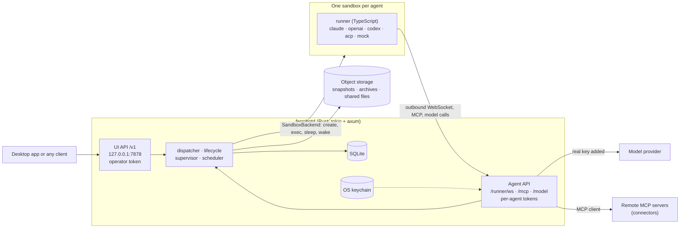

One daemon owns everything; each agent's sandbox runs a small runner that
dials out to it. Clients only ever see the daemon's `/v1` API.

## Daemon

`ferrobotd` holds all state and logic. It listens on two addresses with
different trust:

- **UI API** (`--listen`, default `127.0.0.1:7878`): the versioned `/v1`
  HTTP and WebSocket API for the operator. Every `/v1` route needs the
  operator token as `Authorization: Bearer <token>`, except `GET /v1/health`
  and the OAuth callback for connector sign-ins (guarded by a single-use
  `state` instead). Pages of files agents share are served under
  `/artifacts/` with signed links that expire after 30 minutes.
  The token is generated on first start into `<data dir>/api-token` (mode
  0600), or set with `--api-token` / `FERROBOT_API_TOKEN`. `GET` requests may
  pass `?access_token=` instead, for WebSockets and images. It is plain HTTP
  and meant for loopback only. Anyone with the token can run any command in
  any agent's computer (`exec`).
- **Agent API** (`--agent-listen`, default `127.0.0.1:7879`): what sandboxes
  call. With Docker it must be reachable from containers, e.g.
  `--agent-listen 0.0.0.0:7879`. Routes: `/runner/ws` (turns and events),
  `/mcp` (agent tools) and `/model` (model proxy). Each sandbox gets its own
  random 256-bit token, stored only as a SHA-256 hash and rotated whenever a
  sandbox is provisioned. An agent can only act as itself: tools read the
  caller from the token.

Inside the daemon, the dispatcher turns mailbox messages into turns, the
lifecycle code creates and wakes sandboxes, the supervisor puts idle agents
to sleep and restarts crashed ones, and the scheduler runs routines (cron with
time zones).

How a message flows: a message lands in an agent's mailbox, the dispatcher
claims it and sends it to that agent's runner as a turn, the runner works on
it with the model and tools and streams events back, and a `send_message`
call puts the reply in another mailbox. A failed turn is retried up to 3
times; a message in flight when a runner or the daemon went away is queued
again when the runner reconnects.

## Model proxy

Model keys stay in the daemon. A sandbox gets the proxy URL and its own agent
token in the place a key would go (for example `ANTHROPIC_BASE_URL` and
`ANTHROPIC_API_KEY`). For each request the proxy:

1. checks the agent token (an unknown token gets `401` before any
   configuration is revealed),
2. looks up the agent's provider; the upstream always comes from the provider
   config, never from the request,
3. drops the inbound credential headers and adds the real credential, read
   from the keychain per request (so a key change needs no restart),
4. streams the response back.

It only forwards an allowlist of calls per API family: Anthropic messages
(and token counting) and model lists; OpenAI-style `chat/completions` and
`models`; Codex `responses`; Gemini `generate` / `streamGenerate` / `count`;
Bedrock invoke and token counting plus the inference-profile list; Vertex
`rawPredict` / `streamRawPredict` below the provider's own project and
region. Anything else is `404`, so a hostile sandbox cannot use a key for
files, batches or fine-tunes. Paths must be plain, redirects are not
followed, and headers pass through allowlists both ways.

See [[Providers]] for how each kind authenticates.

## Runner and drivers

The runner is a Node/TypeScript program inside each sandbox. It connects out
to the daemon over a WebSocket, so a sandbox needs no inbound port, and
reconnects after sleep or a daemon restart. A driver connects it to a model
harness:

| Driver | Harness | Used for |
| --- | --- | --- |
| `claude` | Claude Agent SDK | Anthropic, Bedrock and Vertex providers, and agents without a provider |
| `openai` | the runner's own tool loop (`bash`, `read_file`, `write_file` plus the agent tools) over an OpenAI-compatible chat API | OpenAI, Gemini, OpenRouter, Ollama, any OpenAI-compatible endpoint |
| `codex` | `codex app-server` inside the sandbox | `codex` providers |
| `acp` | Gemini CLI over the Agent Client Protocol | `gemini_cli` providers |
| `claude_code` | the daemon computer's own `claude` CLI, run by the daemon per turn; the runner only hands it the turn | `claude_code` providers (opt-in, your own login) |
| `mock` | a deterministic fake, no model | `--driver mock` (tests, demos) |

`--driver mock` forces the mock driver for every agent. `--driver claude`
means "real models": each agent's provider picks its driver.

The runner refuses obviously destructive shell commands and keeps its file
tools inside the agent's home. That is a second line of defence, not a
sandbox, and it mostly does not apply to Codex and Gemini CLI, which run
many commands without asking. The sandbox is the boundary.

Messages you send while an agent works reach the running turn with the
`claude` and `openai` drivers; with `codex` and `acp` they wait for the next
turn.

## Sandbox backends

The daemon talks to sandboxes only through the `SandboxBackend` trait:
create, exec, files, sleep, wake, stop, snapshots. Docker is the default;
the Firecracker backend is written but has never booted. See
[[Sandbox Backends|Sandbox-Backends]].

## Store

State lives in SQLite (`<data dir>/ferrobot.db`): agents and profiles, the
mailbox, the event log, per-agent and global memory with FTS5 full-text
search, routines and their runs, snapshot metadata, providers and connectors.
Migrations are forward-only and tracked with `PRAGMA user_version`; an older
daemon cannot open a database a newer one has migrated.

Secrets are never in SQLite. Provider keys, sign-ins, connector tokens and
the archive key live in the OS keychain (macOS Keychain, Windows Credential
Manager, Secret Service). `--secret-store file` writes a plaintext
`secrets.json` for headless CI only.

Blobs go to object storage (`--storage-url`, default the data dir;
`s3://bucket/prefix` for S3 or R2): snapshot home archives, sandbox archives
and files agents share. Archives are encrypted; shared files are not. No real
S3 or R2 bucket has been used yet.

## Agent tools (MCP)

The daemon runs an MCP server (rmcp, Streamable HTTP, stateless) at `/mcp`.
Every driver uses it, authenticated with the agent's token:

| Tool | What it does |
| --- | --- |
| `list_agents` | Lists the other agents. |
| `send_message` | Puts a message in another agent's mailbox (`reply_to`, `priority`). |
| `read_mailbox` | Reads the agent's mail. |
| `ask_user` | Shows the operator a question card; the answers come back as a message. |
| `create_agent` | Asks the operator to approve a new agent (unless Auto mode is on), then creates it. |
| `share_file` | Copies a file from the sandbox to object storage and shows it in the chat. |
| `remember`, `recall`, `forget` | Memory with full-text search; `global: true` shares an entry with all agents. |

`create_agent` waits for an Approve/Decline card. No answer within
`FERROBOT_APPROVAL_TIMEOUT` (default 300 s) counts as declined, and a host
keeps at most `FERROBOT_MAX_AGENTS` agents (default 10). With Auto mode on
(`PUT /v1/settings`) it creates the agent without a card and records an
`agent_created` notice in the chat; the limit still applies.

## Connectors

The daemon is an MCP client of remote MCP servers (Streamable HTTP only, no
local stdio servers). It lends their tools to the agents you assign, named
`<connector>__<tool>`. The connector's token, static or from an OAuth
sign-in, stays in the keychain and never reaches a sandbox. The assignment is
checked on every call. No real third-party connector has been tested yet.

## Desktop app and API contract

The desktop app is a Tauri v2 window with a Preact UI. It has no Tauri
commands and no business logic: it uses the `/v1` API like any other client.
The OpenAPI spec and JSON Schemas in `protocol/` are generated from the Rust
types and checked in CI; see
[protocol/README.md](../blob/main/protocol/README.md).
